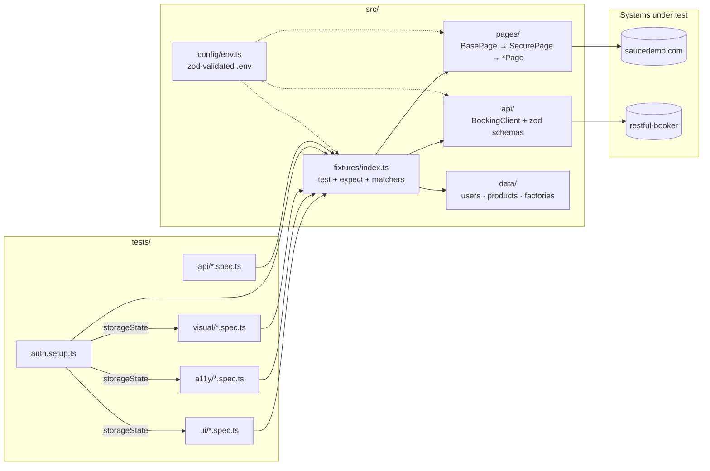
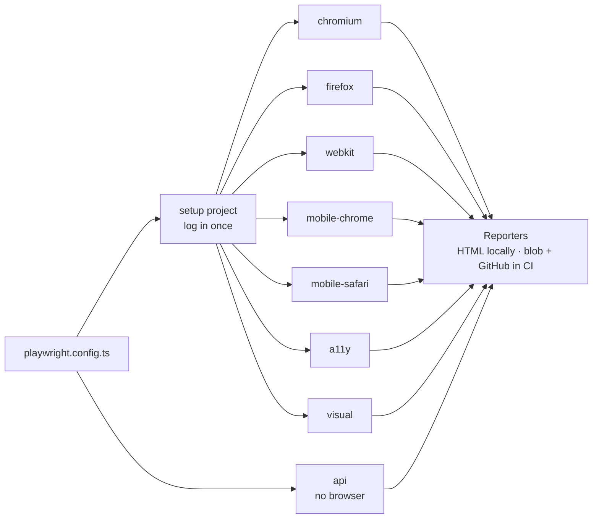
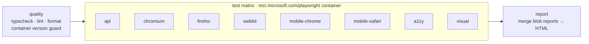

<div align="center">

# 🎭 playwright-ai-starter

**A production-ready Playwright + TypeScript test automation template, ready to be extended by AI coding agents.**

UI · API · Accessibility · Visual regression · Cross-browser & mobile · CI with artifacts · `CLAUDE.md` / `AGENTS.md` / Skills

[](https://github.com/sergiopiedra/playwright-ai-starter/actions/workflows/playwright.yml)
[](https://playwright.dev)
[](https://www.typescriptlang.org)
[](https://nodejs.org)
[](https://github.com/dequelabs/axe-core)
[](https://prettier.io)
[](LICENSE)

</div>

---

## What is this?

`playwright-ai-starter` is a **template repository** you can clone to start a new test automation
project with sensible defaults already in place. It ships with a working test suite against two
public demo targets:

| Target                                                        | Type           | What we test                                     |
| ------------------------------------------------------------- | -------------- | ------------------------------------------------ |
| [Sauce Demo](https://www.saucedemo.com)                       | E-commerce SPA | Login, cart, checkout, a11y, visual regression   |
| [Restful Booker](https://restful-booker.herokuapp.com/apidoc) | REST API       | Auth, CRUD on bookings, contract (schema) checks |

It is also designed for **AI-assisted development**. [`AGENTS.md`](AGENTS.md) and
[`CLAUDE.md`](CLAUDE.md) document the conventions, and three [Claude Code skills](.claude/skills)
teach an agent how to add page objects, write tests from user stories and fix flaky tests in
this repo's own style.

## Table of contents

- [Features](#-features)
- [Architecture](#-architecture)
- [Project structure](#-project-structure)
- [Quick start](#-quick-start)
- [Running tests](#-running-tests)
- [Configuration & environments](#-configuration--environments)
- [Test types](#-test-types)
- [Reports & debugging](#-reports--debugging)
- [CI/CD (GitHub Actions)](#-cicd-github-actions)
- [AI-assisted development](#-ai-assisted-development)
- [Writing your first test](#-writing-your-first-test)
- [Known quirks & troubleshooting](#-known-quirks--troubleshooting)
- [Using this as a template](#-using-this-as-a-template)

## ✨ Features

| Area                  | What you get                                                                                               |
| --------------------- | ---------------------------------------------------------------------------------------------------------- |
| **Page Object Model** | `BasePage` → `SecurePage` → pages, plus reusable components (`HeaderComponent`)                            |
| **Custom fixtures**   | Page objects, API clients, worker-scoped auth token, auto-cleaned test data, a11y scanner                  |
| **Custom matcher**    | `expect(results).toHaveNoViolations({ allow })` with readable violation output                             |
| **Typed env config**  | `.env.dev` / `.env.prod` / `.env.local`, validated with **zod**; fails fast with clear errors              |
| **UI tests**          | Login (incl. data-driven negatives), cart, sorting, checkout with price/tax verification                   |
| **API tests**         | Playwright `request` + typed client + zod schemas for contract checks                                      |
| **Accessibility**     | `@axe-core/playwright`, WCAG 2.1 A/AA, with a "known issues" baseline so only _new_ problems fail          |
| **Visual regression** | Full-page & component snapshots, masked dynamic content, per-platform baselines                            |
| **Tags**              | `@smoke` and `@regression` using Playwright's native tag API                                               |
| **Cross-browser**     | Chromium, Firefox, WebKit + Pixel 7 & iPhone 15 emulation, fully parallel                                  |
| **Auth reuse**        | Setup project logs in once; specs reuse the storage state                                                  |
| **Quality gates**     | Strict TypeScript, ESLint (typed rules + `eslint-plugin-playwright`), Prettier                             |
| **CI**                | GitHub Actions matrix in the official Playwright container, merged HTML report, traces/videos as artifacts |
| **AI conventions**    | `AGENTS.md`, `CLAUDE.md`, project permissions and 3 skills under `.claude/skills`                          |

## 🏗 Architecture



**How a test run flows:**



### Design principles

- **Tests read like specs.** All mechanics (selectors, waits, parsing) live in page objects and clients.
- **Synchronise on state, never on time.** Web-first assertions only; `waitForTimeout` is lint-banned.
- **Every test is independent.** Unique data per test (faker factories) and self-cleaning fixtures, so everything runs fully parallel.
- **Fail loudly and early.** Invalid env config, API contract drift and floating promises all fail with clear messages.

## 📁 Project structure

```
playwright-ai-starter/
├── .claude/
│   ├── settings.json                # Project permissions for Claude Code
│   └── skills/
│       ├── new-page-object/         # SKILL.md + dump-locators.mjs + template.ts
│       ├── test-from-user-story/    # SKILL.md
│       └── fix-flaky-test/          # SKILL.md
├── .github/
│   ├── workflows/playwright.yml     # CI pipeline
│   └── dependabot.yml
├── src/
│   ├── api/                         # BookingClient, zod schemas
│   ├── config/env.ts                # Typed env loader
│   ├── data/                        # USERS, PRODUCTS, buildCustomer(), buildBooking()
│   ├── fixtures/index.ts            # Custom test/expect
│   ├── pages/                       # BasePage, SecurePage, page objects, components/
│   └── utils/                       # money + a11y helpers
├── tests/
│   ├── auth.setup.ts
│   ├── ui/        login · cart · checkout
│   ├── api/       auth · booking
│   ├── a11y/      accessibility
│   ├── visual/    visual
│   └── __screenshots__/             # Visual baselines (linux = CI, darwin = local)
├── .env.dev · .env.prod · .env.example
├── AGENTS.md · CLAUDE.md
├── playwright.config.ts · tsconfig.json · eslint.config.mjs · .prettierrc.json
└── package.json
```

## 🚀 Quick start

**Prerequisites:** Node.js 20+ (24 recommended, see `.nvmrc`) and Git.

```bash
# 1. Get the code (or click "Use this template" on GitHub)
git clone https://github.com/sergiopiedra/playwright-ai-starter.git
cd playwright-ai-starter

# 2. Install dependencies and browsers
npm ci
npx playwright install --with-deps

# 3. Run the smoke suite
npm run test:smoke

# 4. Open the HTML report
npm run report
```

No configuration is needed for the demo targets: `.env.dev` contains their public demo credentials.

## 🧪 Running tests

| Command                      | What it does                                                |
| ---------------------------- | ----------------------------------------------------------- |
| `npm test`                   | Everything: all projects, all tags                          |
| `npm run test:smoke`         | Only `@smoke` tests (critical paths, read-only)             |
| `npm run test:regression`    | Only `@regression` tests                                    |
| `npm run test:e2e`           | UI specs on all 5 browser/device projects                   |
| `npm run test:chromium`      | UI specs on Chromium only (fastest feedback)                |
| `npm run test:mobile`        | UI specs on Pixel 7 + iPhone 15                             |
| `npm run test:api`           | API specs (no browser)                                      |
| `npm run test:a11y`          | Accessibility scans                                         |
| `npm run test:visual`        | Visual regression                                           |
| `npm run test:visual:update` | Re-generate local visual baselines (review the diff first!) |
| `npm run test:prod`          | `@smoke` against `TEST_ENV=prod` (mutations skipped)        |
| `npm run test:headed`        | Chromium, headed                                            |
| `npm run test:debug`         | Playwright Inspector, step through                          |
| `npm run test:ui-mode`       | Playwright UI mode (watch, time-travel)                     |
| `npm run report`             | Open the last HTML report                                   |
| `npm run codegen`            | Record interactions against Sauce Demo                      |
| `npm run check`              | Typecheck + lint + format check (run before committing)     |

Any Playwright CLI flag works too:

```bash
npx playwright test tests/ui/checkout.spec.ts --project=webkit       # one file, one browser
npx playwright test -g "complete a purchase" --project=chromium      # one test by title
npx playwright test --grep @smoke --grep-invert @regression          # tag logic
npx playwright test --project=chromium --repeat-each=10              # flakiness check
```

### Projects

| Project         | Device          | Runs                  |
| --------------- | --------------- | --------------------- |
| `setup`         | Desktop Chrome  | `tests/auth.setup.ts` |
| `api`           | (none)          | `tests/api/**`        |
| `chromium`      | Desktop Chrome  | `tests/ui/**`         |
| `firefox`       | Desktop Firefox | `tests/ui/**`         |
| `webkit`        | Desktop Safari  | `tests/ui/**`         |
| `mobile-chrome` | Pixel 7         | `tests/ui/**`         |
| `mobile-safari` | iPhone 15       | `tests/ui/**`         |
| `a11y`          | Desktop Chrome  | `tests/a11y/**`       |
| `visual`        | Desktop Chrome  | `tests/visual/**`     |

### Tags

Tags use Playwright's native API and can be combined:

```ts
test('customer can complete a purchase', { tag: ['@smoke', '@regression'] }, async ({ ... }) => { ... });
```

- **`@smoke`**: critical happy paths. Fast, and safe to run against production.
- **`@regression`**: the full behavioural suite.

## ⚙️ Configuration & environments

Select an environment with `TEST_ENV` (default `dev`):

```bash
TEST_ENV=prod npx playwright test --grep @smoke
```

Values are resolved in this order (first wins):

1. Real environment variables (e.g. CI secrets)
2. `.env.local` (git-ignored, for your personal overrides and secrets)
3. `.env.<TEST_ENV>` (committed, non-secret defaults)

| Variable              | Description                                               | dev        | prod       |
| --------------------- | --------------------------------------------------------- | ---------- | ---------- |
| `BASE_URL`            | Web app under test                                        | ✅         | ✅         |
| `SAUCE_PASSWORD`      | Password for Sauce Demo users                             | demo value | **secret** |
| `API_URL`             | API under test                                            | ✅         | ✅         |
| `API_USERNAME`        | API admin user                                            | ✅         | ✅         |
| `API_PASSWORD`        | API admin password                                        | demo value | **secret** |
| `ALLOW_DATA_MUTATION` | When `false`, tests that create/update/delete are skipped | `true`     | `false`    |

Everything is validated by [`src/config/env.ts`](src/config/env.ts). A missing or malformed value
stops the run immediately:

```
Error: Invalid environment configuration for TEST_ENV=prod:
✖ Invalid input: expected string, received undefined
  → at SAUCE_PASSWORD
```

> Copy `.env.example` to `.env.local` to override anything locally. **Never commit real secrets.**

## 🔬 Test types

### UI (`tests/ui`)

Page objects are injected as fixtures, and authenticated specs reuse the storage state from the setup project:

```ts
test.use({ storageState: STORAGE_STATE.standard });

test(
  'order overview shows correct subtotal, tax and total',
  { tag: '@regression' },
  async ({ checkoutInformationPage, checkoutOverviewPage }) => {
    await checkoutInformationPage.submit(buildCustomer());

    expect(await checkoutOverviewPage.getSummary()).toEqual({
      subtotal: 39.98,
      tax: 3.2,
      total: 43.18,
    });
  },
);
```

### API (`tests/api`)

A thin typed client returns raw `APIResponse`s, so tests can assert status codes. Bodies are validated with zod, so contract drift fails loudly:

```ts
test('retrieves a booking by id', async ({ bookingApi, createdBooking }) => {
  const response = await bookingApi.getBooking(createdBooking.bookingid);

  await expect(response).toBeOK();
  expect(BookingSchema.parse(await response.json())).toEqual(createdBooking.booking);
});
```

The `createdBooking` fixture creates fresh data before the test and deletes it afterwards.

### Accessibility (`tests/a11y`)

```ts
expect(await a11y.scan()).toHaveNoViolations(); // WCAG 2.1 A + AA
expect(await a11y.scan({ tags: ['best-practice'] })).toHaveNoViolations({
  allow: ['page-has-heading-one', 'region'],
}); // baseline known issues
```

The full axe JSON is attached to every test in the HTML report. Failures print a readable list of rules, impact, help links and offending selectors.

### Visual regression (`tests/visual`)

```ts
await expect(page).toHaveScreenshot('inventory.png', {
  fullPage: true,
  mask: [page.getByTestId('footer-copy')], // the footer shows the current year
});
```

Baselines are **per platform** (`*-linux.png` for CI, `*-darwin.png` for macOS). To refresh them:

- **Locally:** `npm run test:visual:update`, then review the images before committing.
- **For CI (linux):** run the workflow manually with **`update_snapshots: true`**, download the
  `visual-baselines` artifact and commit it. New snapshots that are missing in CI are also
  published there automatically, with a warning annotation.

## 📊 Reports & debugging

- **HTML report:** `npm run report` (traces, screenshots, videos and axe results attached).
- **Traces:** recorded on the first retry. Open with `npx playwright show-trace <trace.zip>`.
- **Failure context:** every failure writes `test-results/**/error-context.md` with the error,
  the failing source line and an **accessibility snapshot** of the page. It's great input for AI agents.
- **Videos & screenshots:** kept only on failure.

## 🔄 CI/CD (GitHub Actions)

[`.github/workflows/playwright.yml`](.github/workflows/playwright.yml) runs on push and PR to `main`,
nightly on weekdays, and on demand.



| Artifact                 | When                        | Contents                             |
| ------------------------ | --------------------------- | ------------------------------------ |
| `playwright-report`      | Always                      | Merged HTML report for all projects  |
| `blob-report-<project>`  | Always                      | Raw blob reports (input for merging) |
| `test-results-<project>` | On failure                  | Traces, screenshots, videos          |
| `visual-baselines`       | When snapshots were written | Linux baselines to commit            |

**Manual run** (_Actions → Playwright Tests → Run workflow_):

| Input              | Description                     |
| ------------------ | ------------------------------- |
| `test_env`         | `dev` or `prod`                 |
| `grep`             | Tag/regex filter, e.g. `@smoke` |
| `update_snapshots` | Regenerate all visual baselines |

**Secrets** (only needed for `prod`): `SAUCE_PASSWORD`, `API_PASSWORD`.

> The container tag in the workflow must match `@playwright/test` in `package.json`.
> The `quality` job checks this and fails with a clear message when they drift.

## 🤖 AI-assisted development

This repo is set up so coding agents produce code that looks like a senior engineer wrote it.

| File                                                                   | Purpose                                                                                             |
| ---------------------------------------------------------------------- | --------------------------------------------------------------------------------------------------- |
| [`AGENTS.md`](AGENTS.md)                                               | Single source of truth for conventions (works with Claude Code, Codex, Cursor, Copilot…)            |
| [`CLAUDE.md`](CLAUDE.md)                                               | Imports `AGENTS.md` and adds Claude Code-specific workflow                                          |
| [`.claude/settings.json`](.claude/settings.json)                       | Allows test/lint commands; denies reading `.env.local` and auth state                               |
| [`new-page-object`](.claude/skills/new-page-object/SKILL.md)           | Inspects the live page, generates a POM from the template, registers the fixture, adds a smoke test |
| [`test-from-user-story`](.claude/skills/test-from-user-story/SKILL.md) | Maps acceptance criteria to scenarios, picks the right layer and tags, implements and verifies      |
| [`fix-flaky-test`](.claude/skills/fix-flaky-test/SKILL.md)             | Reproduces under stress, reads traces, classifies the race, proves the fix statistically            |

Example prompts in Claude Code:

```text
> Create a page object for the product details page (/inventory-item.html?id=4)

> Automate this story: As a shopper I want to sort products by price
  so that I can find the cheapest item. AC: low→high and high→low orders are correct.

> tests/ui/cart.spec.ts "cart lists exactly the products" fails ~5% on webkit, fix it
```

The `fix-flaky-test` skill includes a **real worked example** from this repo: a 404 SPA-redirect
race on WebKit, taken from 2/123 failing runs to 0/363.

## ✍️ Writing your first test

```ts
// tests/ui/sorting.spec.ts
import { expect, test } from '@fixtures';
import { STORAGE_STATE } from '@data/users';
import { SORT_OPTIONS } from '@pages';

test.use({ storageState: STORAGE_STATE.standard });

test(
  'shopper can sort products by price, high to low',
  { tag: '@regression' },
  async ({ inventoryPage }) => {
    await inventoryPage.goto();

    await inventoryPage.sortBy(SORT_OPTIONS.priceDesc);

    const prices = await inventoryPage.getItemPrices();
    expect(prices).toEqual([...prices].sort((a, b) => b - a));
  },
);
```

Checklist (also in [`AGENTS.md`](AGENTS.md#definition-of-done)):

1. Import `test`/`expect` from `@fixtures`, and use page-object fixtures.
2. Tag it (`@smoke` and/or `@regression`).
3. `npm run check` passes.
4. It passes on chromium **and** webkit with `--repeat-each=3`.

## 🩺 Known quirks & troubleshooting

| Symptom                                           | Cause / fix                                                                                                                   |
| ------------------------------------------------- | ----------------------------------------------------------------------------------------------------------------------------- |
| Flaky first interaction after navigating (WebKit) | Sauce Demo deep links go through a 404 → SPA redirect shim. Always use `somePage.goto()`, which waits for the final document. |
| Logged out halfway through a long run             | Sauce Demo's cookie lasts 10 min. `auth.setup.ts` stores it as a session cookie, so re-run setup if you changed it.           |
| `DELETE /booking/:id` returns `201`               | Restful Booker quirk, asserted on purpose. Bad credentials also return `200` with `{ reason }`.                               |
| API tests fail with 5xx / timeouts                | Restful Booker is a shared free sandbox that sleeps and resets. Re-run; CI retries twice.                                     |
| `A snapshot doesn't exist … writing actual`       | First run on a new platform. Review the image, then commit it (see [Visual regression](#visual-regression-testsvisual)).      |
| `Invalid environment configuration`               | A required variable is missing for that `TEST_ENV`. Add it to `.env.local` or CI secrets.                                     |
| `Executable doesn't exist` in CI                  | The container tag and `@playwright/test` version drifted. Align them (the `quality` job tells you which).                     |

## 📦 Using this as a template

1. Click **Use this template** on GitHub (or clone it) and rename the package in `package.json`.
2. Point `BASE_URL` / `API_URL` in `.env.dev` / `.env.prod` at your apps.
3. Replace the page objects in `src/pages` (ask your agent to use the `new-page-object` skill).
4. Replace the API client and schemas in `src/api`.
5. Delete the demo specs, keep the structure, and run `npm run check`.
6. Add `SAUCE_PASSWORD` / `API_PASSWORD` (renamed for your app) as repository secrets.

## 📄 License

[MIT](LICENSE)
